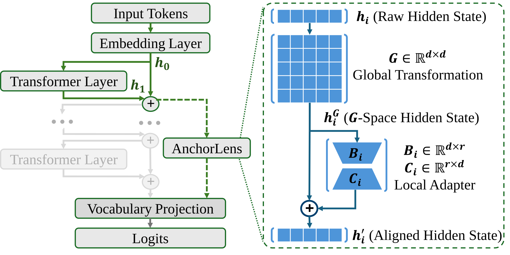
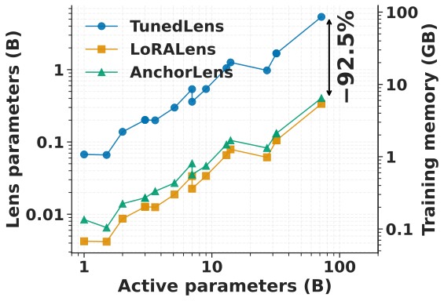
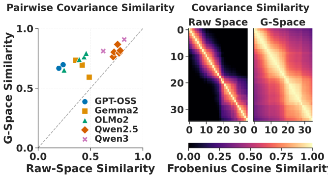
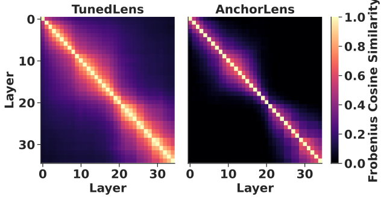

# Interpretability Lenses

Code for training and evaluating **lenses**: small models that decode the hidden state of any intermediate layer of an LLM into a next-token distribution, showing what the model "is about to say" at that depth.

This repository is the official implementation of two papers from the University of Parma:

> 📄 **AnchorLens: A Shared Coordinate System for Interpreting Intermediate Representations in Large Language Models**
> · Giuseppe Trimigno, Gianfranco Lombardo, Stefano Cagnoni · **EMNLP 2026** (**Main Conference**) · [paper](https://aclanthology.org/2026.emnlp-main.2385/)
>
> 📄 **Low-Rank Lens for Scalable LLMs Interpretability** (LoRALens)
> · Giuseppe Trimigno, Gianfranco Lombardo, Stefano Cagnoni · **ESANN 2026** · [paper](https://www.esann.org/sites/default/files/proceedings/2026/ES2026-221.pdf)

It also includes the two lenses they build on, **LogitLens** and **TunedLens**, so all four can be trained and compared under the same setup.

### Why low-rank lenses

TunedLens learns a full d×d translator for every layer. For a 72B model that is 5.4B lens parameters and about 86 GB of GPU memory just to train the lens. Yet the learned translators are far from full-rank. Spectral analysis across model families shows they live in a highly compressed subspace: their stable rank stays below 3% of the hidden size.

**LoRALens** uses this directly. It replaces each translator with a low-rank residual update of rank r = ⌊d/32⌋, cutting the lens parameters by over 95% while keeping per-layer fidelity close to TunedLens. On OLMo (1B–32B), Qwen2.5 (1.5B–32B) and Gemma2 (2B–27B), the paper also shows that:
- lenses trained on base models transfer to their instruction-tuned versions without retraining;
- intermediate layers allow accurate *linear shortcuts* to the final prediction.

### Why a shared coordinate system

LoRALens still treats every layer independently. Yet the per-layer alignment problems are not independent. If the TunedLens translators are stacked and decomposed, their first singular component alone explains 31–64% of the total spectral variance (42% on average), 10–20× more than unrelated translators would share.

**AnchorLens** factors this shared structure out:
- A single full-rank matrix `G`, shared by all layers, maps every hidden state into a common coordinate system.
- A per-layer low-rank adapter corrects only what is specific to each layer.
- The two are trained in two stages: `G` first, then the adapters with `G` frozen.

<p align="center">
  
</p>
<p align="center"><em>AnchorLens decodes a layer in two steps: the shared matrix G maps the raw hidden state into the common G-space, then the layer's low-rank adapter B<sub>i</sub>C<sub>i</sub> adds a residual correction.</em></p>

Results across 16 models from five families (GPT-OSS, Qwen3, Qwen2.5, OLMo2, Gemma2; 1B to 120B parameters):
- **Accuracy:** AnchorLens matches TunedLens and outperforms LoRALens on next-token prediction and on linear-shortcut evaluations over eight benchmarks.
- **Cost:** it uses over 90% fewer parameters than TunedLens (0.40B instead of 5.37B on Qwen2.5-72B), and its overhead over LoRALens, a single shared d×d matrix, shrinks as models grow.

<p align="center">
  
</p>
<p align="center"><em>Lens parameters and GPU training memory as model size grows (log–log). AnchorLens needs 92.5% less parameters and training memory than TunedLens.</em></p>

- **Analysis:** because all layers share the coordinate system of `G`, they can be compared directly. `G` reduces the representational drift between layers, and after training the per-layer adapters become nearly orthogonal to each other.

<table>
  <tr>
    <td width="50%" align="center"></td>
    <td width="50%" align="center"></td>
  </tr>
  <tr>
    <td align="center"><em><b>G reduces drift.</b> Similarity between cross-layer hidden-state covariances, before and after mapping them with G. Every model lies above the diagonal, and the average goes from 0.53 to 0.76. The heatmaps show GPT-OSS-120B.</em></td>
    <td align="center"><em><b>Adapters become layer-specific</b> (GPT-OSS-120B). TunedLens translators share a broad common structure across layers. Once G absorbs it, the AnchorLens adapters are nearly orthogonal, with 75% lower off-diagonal similarity.</em></td>
  </tr>
</table>

## Lenses

Every lens maps the hidden state `h_ℓ` of layer `ℓ` to a hidden state that the model's own output head (final norm + unembedding) turns into logits. They differ only in that mapping:

| Lens | Mapping of layer ℓ | Trainable parameters | Reference |
|---|---|---|---|
| `LogitLens` | `h_ℓ` | none | [nostalgebraist, 2020](https://www.lesswrong.com/posts/AcKRB8wDpdaN6v6ru/interpreting-gpt-the-logit-lens) |
| `TunedLens` | `h_ℓ + A_ℓ h_ℓ + b_ℓ` | L·(d² + d) | [Belrose et al., 2023](https://arxiv.org/abs/2303.08112) |
| `LoRALens` | `h_ℓ + B_ℓ C_ℓ h_ℓ + b_ℓ` | L·(2dr + d) | [Trimigno et al., ESANN 2026](https://doi.org/10.14428/esann/2026.ES2026-221) |
| `AnchorLens` | `(I + B_ℓ C_ℓ) h^G_ℓ + b_ℓ`, with `h^G_ℓ = G h_ℓ + b_G` | (d² + d) + L·(2dr + d) | Trimigno et al., EMNLP 2026 |

Here d is the hidden size, L the number of decoded layers, and r = d / `rank_factor` the adapter rank (32 in both papers).

All trainable lenses start out as LogitLens: the residual updates are zero-initialized, and `G` is initialized to the identity. They are then trained by distillation from the model itself, minimizing at every layer the KL divergence between the model's final next-token distribution and the lens' one.

## Installation

```bash
pip install torch transformers datasets accelerate wandb tqdm
pip install flash-attn --no-build-isolation           # optional, see below
wandb login                                           # training logs to Weights & Biases
```

- Training with Muon requires a PyTorch version that ships `torch.optim.Muon` (2.9 or later).
- Models are loaded with `flash_attention_2` by default. Without `flash-attn` installed, add `"attn_implementation": "sdpa"` to the `model` section of your configs.
- Tested with `torch==2.13.0+cu132`, `flash_attn==2.8.3+cu132torch2.13`, `transformers==5.20.2`, `accelerate==1.15.0`, `wandb==0.31.0`, and `tqdm==4.70.1`.

All commands below are meant to be run **from the repository root**: datasets, checkpoints and results are read and written relative to it.

## Data

Lenses are trained and evaluated on two subsets of [SlimPajama](https://huggingface.co/datasets/gmongaras/SlimPajama-627B_Reupload), the same used in both papers:

| File | Used for | Tokens | Size |
|---|---|---|---|
| `SlimPajamaTrain.json` | training (`train.py`) | 226.49M | ~1 GB |
| `SlimPajamaDevSubset.json` | evaluation (`eval.py`) | 18.66M | ~80 MB |

They are distributed as on Google Drive: **[download the datasets](https://drive.google.com/file/d/14dePhIRZqzDnN6LeKxtxLrDGCakklCNd/view?usp=sharing)**. Unpack it into `reproduce/dataset/`.

Both are JSON Lines files, with one `{"text": ...}` object per line. Documents are concatenated with EOS separators and cut into chunks of `max_seq_len` tokens, without padding. Losses are reported in **bits per byte**, which, unlike a per-token loss, can be compared across models with different tokenizers.

The LSC stage does not use these files: it downloads its benchmarks from the Hugging Face Hub (see [LSC](#3-lsc-linear-shortcut-ability)).

## Quick start

Configs for the small `Qwen/Qwen3-0.6B` train every lens for 20 steps and evaluate on 16k tokens: a quick way to check that everything runs before moving to large models.

```bash
python train.py --config reproduce/config/train/Qwen3-0.6B/TunedLens-AdamW.json
python eval.py  --config reproduce/config/eval/Qwen3-0.6B/TunedLens-AdamW-20_steps.json
python lsc.py   --config reproduce/config/eval/Qwen3-0.6B/TunedLens-AdamW-20_steps.json
```

These runs log to the wandb project `InterpretabilityLens-Repo-Test`.

## Usage

Each stage is a script that takes a single JSON config. Ready-made configs are in `reproduce/config/`, for `Qwen3-32B` and `gpt-oss-120b` (the setups of the papers) and `Qwen3-0.6B` (testing):

```
reproduce/config/
├── train/<model>/<lens>.json
└── eval/<model>/<lens>-<steps>_steps.json   # used by both eval.py and lsc.py
```

### 1. Training

```bash
python train.py --config reproduce/config/train/<model>/<config>.json
```

A training config has three sections, `model`, `dataset` and `optimizer`, plus the training settings:

```json
{
    "model": {"name_or_path": "Qwen/Qwen3-32B", "device_map": "cuda:0"},
    "optimizer": {"optimizer": "AdamW", "lr_scale": 1.0, "warmup_steps": 25},
    "dataset": {"name": "SlimPajamaTrain.json", "max_seq_len": 2048},
    "lens_type": "LoRALens",
    "lens_config": {"device": "cuda:0", "rank_factor": 32, "bias": true},
    "num_steps": 500,
    "tokens_per_step": 262144,
    "batch_size": 4,
    "save_steps": [25, 50, 100, 150, 200, 300, 400, 500],
    "wandb_project": "LensTraining",
    "seed": 42
}
```

| Key | Meaning |
|---|---|
| `model` | Hugging Face model id, plus loading options (`device_map`, `precision`, `attn_implementation`, ...). |
| `optimizer.optimizer` | `"AdamW"` (base LR 1e-3) or `"Muon"` (base LR 1e-2 for the weight matrices, 1e-3 with AdamW for the biases). |
| `optimizer.lr_scale` | Multiplier on the base LR. |
| `optimizer.warmup_steps` | Linear LR warmup, after which the LR decays linearly to zero at `num_steps`. Defaults to 10% of `num_steps` (at most 1000); the paper configs use 25. |
| `dataset.name` | File in `reproduce/dataset/`. |
| `lens_type` | `"TunedLens"`, `"LoRALens"` or `"AnchorLens"`. |
| `lens_config` | Lens hyperparameters: see the lens-specific examples below. |
| `num_steps` | Optimizer steps: 500 for TunedLens and LoRALens; 300 (stage 1) + 200 (stage 2) for AnchorLens, as in the papers. |
| `tokens_per_step` | Tokens per optimizer step. Must be a multiple of `max_seq_len`; gradient accumulation is derived from it. |
| `batch_size` | Chunks per forward pass. |
| `save_steps` | Steps after which a checkpoint is saved. The final step is always saved. |
| `checkpoint_freq` | Optional: every how many steps to write a resumable snapshot. An interrupted run restarts from the latest one. |

**TunedLens**

```bash
python train.py --config reproduce/config/train/Qwen3-32B/TunedLens-AdamW.json
python train.py --config reproduce/config/train/Qwen3-32B/TunedLens-Muon.json
```
```json
"lens_type": "TunedLens",
"lens_config": {"device": "cuda:0", "bias": true}
```

**LoRALens**

```bash
python train.py --config reproduce/config/train/Qwen3-32B/LoRALens-rf_32-AdamW.json  # Support also for Muon optimizer
```
```json
"lens_type": "LoRALens",
"lens_config": {"device": "cuda:0", "rank_factor": 32, "bias": true}
```

The adapters have rank `hidden_size / rank_factor`.

**AnchorLens**

Two runs, in this order:

```bash
# Stage 1: global transformation only
python train.py --config reproduce/config/train/Qwen3-32B/AnchorLens-G-AdamW.json  # Support also for Muon optimizer

# Stage 2: per-layer adapters on top of the frozen global transformation from stage 1
python train.py --config reproduce/config/train/Qwen3-32B/AnchorLens-G-L-rf_32-AdamW.json  # Support also for Muon optimizer
```
```json
"lens_type": "AnchorLens",
"lens_config": {"device": "cuda:0", "bias": true, "use_global": true, "use_locals": false}
```
```json
"lens_type": "AnchorLens",
"lens_config": {"device": "cuda:0", "bias": true, "use_global": true, "use_locals": true,
                "rank_factor": 32, "global_init": "300"}
```

`global_init` picks the stage-1 checkpoint to start from: a number of steps, or `"latest"`. The stage-1 run must use the same optimizer, since checkpoints are looked up by optimizer name.

### 2. Evaluation

```bash
python eval.py --config reproduce/config/eval/<model>/<config>.json
```

Decodes every layer on held-out text and reports, per layer and in bits per byte:

- **Kullback-Leibler**: KL(p_final ‖ p_lens), the distance from the model's own prediction;
- **Cross-Entropy**: how well the lens predicts the actual next token;
- **Entropy**: how spread out the lens distribution is.

```json
{
  "model": {"name_or_path": "Qwen/Qwen3-32B", "device_map": "cuda:0"},
  "dataset": {"name": "SlimPajamaDevSubset.json", "max_seq_len": 2048},
  "lens_type": "LoRALens",
  "lens_pretrained_path": "LoRALens-rf_32-AdamW/500_steps",
  "seed": 42,
  "batch_size": 1,
  "num_eval_tokens": 1048576
}
```

`lens_pretrained_path` is relative to `checkpoints/<model>/`. The `seed` fixes the random subset of `num_eval_tokens` tokens, so every lens of a model is evaluated on the same text. For LogitLens, set `"lens_type": "LogitLens"` and leave out `lens_pretrained_path`:

```bash
python eval.py --config reproduce/config/eval/Qwen3-32B/LogitLens.json
python eval.py --config reproduce/config/eval/Qwen3-32B/TunedLens-AdamW-500_steps.json
python eval.py --config reproduce/config/eval/Qwen3-32B/LoRALens-AdamW-rf_32-500_steps.json
python eval.py --config reproduce/config/eval/Qwen3-32B/AnchorLens-G-AdamW-300_steps.json
python eval.py --config reproduce/config/eval/Qwen3-32B/AnchorLens-G-L-AdamW-rf_32-200_steps.json
```

### 3. LSC (Linear Shortcut Ability)

```bash
python lsc.py --config reproduce/config/eval/<model>/<config>.json
```

This is the Linear Shortcut Ability (LSA) evaluation of the papers. It measures, layer by layer, how close the lens' predictions are to the model's final ones on the answers of eight benchmarks: MMLU-Pro, GPQA-Diamond, MATH-500, AIME-2024, AIME-2025, HumanEval, MBPP and IFEval. Each item is fed as a full chat (prompt and reference answer, formatted with the model's chat template) in a single forward pass, and only the answer tokens are scored:

- **Surprisal**: −log P_final(t), where t is the lens' top token, in nats;
- **Precision@k**: the lens' top-1 token is among the model's top-k (k = 1, 5);
- **Recall@k**: the model's top-1 token is among the lens' top-k (k = 1, 5).

> **Reference answers vs. the model's own answers.** To make LSC quick to try, the built-in datasets come with a ready-made answer for every question: the dataset's own solutions or chain of thought (e.g. [`Sunny8781/AIME2025_w_solution`](https://huggingface.co/datasets/Sunny8781/AIME2025_w_solution) for AIME-2025, the canonical code for HumanEval and MBPP). The model under study reads these answers but did not write them.
>
> To run LSC on a model with a benchmark dataset faithfully, score the answers the model itself produces:
> 1. **Generate** the model's answers to the questions of the benchmark, e.g. with [vLLM](https://github.com/vllm-project/vllm). Build the prompts with the same templates as `src/benchmark_dataset.py` (`MC_TEMPLATE`, `MATH_TEMPLATE`, ...), and use the same chat settings: the system prompt from `MODEL2SYSPROMPT`, `enable_thinking=False`, or `reasoning_effort="low"` for gpt-oss. Otherwise the transcript scored later differs from the one the model answered.
> 2. **Save** a dataset with one row per question: the prompt in `formatted_prompt`, and the generated answer in `formatted_completion`.
> 3. **Register** it in `BenchmarkDataset._load_and_prepare` as a new name returning those two columns, and list that name in `dataset_names` in `lsc.py`.
>
> The LSC code itself does not change: it scores any question + answer dataset the same way.

It uses the same configs as `eval.py` (the `dataset` and `num_eval_tokens` keys are ignored), so every lens is run the same way:

```bash
python lsc.py --config reproduce/config/eval/Qwen3-32B/LogitLens.json
python lsc.py --config reproduce/config/eval/Qwen3-32B/TunedLens-AdamW-500_steps.json
python lsc.py --config reproduce/config/eval/Qwen3-32B/LoRALens-AdamW-rf_32-500_steps.json
python lsc.py --config reproduce/config/eval/Qwen3-32B/AnchorLens-G-L-AdamW-rf_32-200_steps.json
```

## Outputs

```
checkpoints/<model>/                       # e.g. Qwen3-32B
├── TunedLens-<opt>/
├── LoRALens-rf_<rf>-<opt>/
├── AnchorLens-G-<opt>/                    # AnchorLens, stage 1
├── AnchorLens-G_<step>-L-rf_<rf>-<opt>/   # AnchorLens, stage 2, started from stage 1 at <step>
│   ├── <N>_steps/                         # one folder per saved step
│   │   ├── config.json
│   │   └── params.pt
│   └── ckpts/snapshot_<N>.pth             # resumable snapshots (if checkpoint_freq is set)

outputs/
├── eval/<model>/<lens folder>-<N>_steps.json            # e.g. LoRALens-rf_32-AdamW-500_steps.json
└── lsc/<model>/<benchmark>/<lens folder>-<N>_steps.json
```

LogitLens results are saved as `LogitLens.json`. Checkpoints contain only the lens parameters: the model's output head is rebuilt from the model when a lens is loaded.

## Repository structure

```
train.py, eval.py, lsc.py   # entry points, one per stage
src/
├── lens/                   # LogitLens, TunedLens, LoRALens, AnchorLens
├── script/                 # training, evaluation and LSC loops
├── unembed.py              # the model's output head, shared by all lenses
├── model.py                # model and tokenizer loading
├── dataset.py              # corpus chunking and tokenization
├── benchmark_dataset.py    # benchmark loading and chat formatting for LSC
├── optimizer.py            # AdamW / Muon and LR schedule
└── state.py                # resumable training state
reproduce/
├── config/                 # configs for every experiment
└── dataset/                # training and evaluation corpora (downloaded separately, see Data)
```

## Citation

If you find our work useful, please cite the corresponding papers.

**AnchorLens: A Shared Coordinate System for Interpreting Intermediate Representations in Large Language Models** (EMNLP 2026):
```bibtex
@inproceedings{trimigno-etal-2026-anchorlens,
    title = "{A}nchor{L}ens: A Shared Coordinate System for Interpreting Intermediate Representations in Large Language Models",
    author = "Trimigno, Giuseppe  and
      Lombardo, Gianfranco  and
      Cagnoni, Stefano",
    editor = "Lee, Hung-Yi  and
      Dev, Sunipa  and
      Li, Jessy  and
      Elliott, Desmond",
    booktitle = "Proceedings of the 2026 Conference on Empirical Methods in Natural Language Processing",
    month = oct,
    year = "2026",
    address = "Budapest, Hungary",
    publisher = "Association for Computational Linguistics",
    url = "https://aclanthology.org/2026.emnlp-main.2385/",
    pages = "54183--54208",
    ISBN = "979-8-89176-459-0"
}
```

**LoRALens** (ESANN 2026):

```bibtex
@inproceedings{trimigno2026lowranklenses,
  author    = {Trimigno, Giuseppe and Lombardo, Gianfranco and Cagnoni, Stefano},
  title     = {Low-Rank Lens for Scalable LLMs Interpretability},
  booktitle = {Proceedings of the 34th European Symposium on Artificial Neural Networks: ESANN 2026},
  year      = {2026},
  month     = {01},
  pages     = {35-40},
  doi       = {10.14428/esann/2026.ES2026-221}
}
```

The LogitLens and TunedLens baselines, which LoRALens and AnchorLens build on:

```bibtex
@article{nostalgebraist2020logitlens,
  title      = {interpreting {GPT}: the logit lens},
  shorttitle = {interpreting {GPT}},
  url        = {https://www.lesswrong.com/posts/AcKRB8wDpdaN6v6ru/interpreting-gpt-the-logit-lens},
  language   = {en},
  author     = {nostalgebraist},
  month      = aug,
  year       = {2020}
}
```

```bibtex
@misc{belrose2025elicitinglatentpredictionstransformers,
  title         = {Eliciting Latent Predictions from Transformers with the Tuned Lens},
  author        = {Nora Belrose and Igor Ostrovsky and Lev McKinney and Zach Furman and Logan Smith and Danny Halawi and Stella Biderman and Jacob Steinhardt},
  year          = {2025},
  eprint        = {2303.08112},
  archivePrefix = {arXiv},
  primaryClass  = {cs.LG},
  url           = {https://arxiv.org/abs/2303.08112}
}
```
